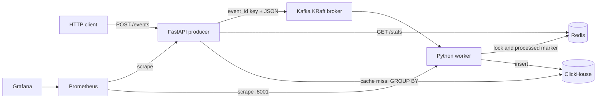

# Event Analytics Pipeline

## Project overview

Event Analytics Pipeline is a compact local portfolio project that demonstrates an end-to-end event flow from an HTTP request to analytical storage. A FastAPI process validates and publishes events to Kafka, while a separate Python worker applies Redis-backed idempotency and inserts them into ClickHouse.

This repository is a local demonstration, not a production platform.

## Features

- Asynchronous `POST /events` ingestion with Pydantic v2 validation
- Kafka topic with one partition and a manually committed consumer offset
- Redis processed markers and expiring locks for idempotent processing
- Decimal-safe JSON messages and `Decimal(18, 2)` ClickHouse storage
- ClickHouse-backed grouped statistics with a 30-second Redis cache
- Liveness, dependency readiness, API metrics, and worker metrics endpoints
- Provisioned Prometheus scraping and a five-panel Grafana dashboard
- Isolated pytest suite, Ruff configuration, smoke test, and GitHub Actions CI

## Architecture



The API and worker use the same Docker image and Python package, but run different commands.

## Event schema

```json
{
  "event_id": "a49c3274-2c53-46a9-98d7-283d49feb951",
  "type": "transaction.completed",
  "amount": 1490.50,
  "currency": "RUB",
  "status": "success",
  "created_at": "2026-08-02T16:30:00Z"
}
```

`event_id` must be a UUID. `type` is a non-empty string up to 100 characters. `amount` must be positive with at most two fractional digits. `currency` must contain exactly three uppercase ASCII letters. `status` is `success`, `failed`, or `pending`. `created_at` must include a timezone.

The API serializes `amount` as a string in Kafka JSON to avoid binary floating-point loss. ClickHouse stores it as `Decimal(18, 2)`.

## Technology stack

- Python 3.13, FastAPI, Uvicorn, Pydantic v2
- aiokafka and Apache Kafka in single-node KRaft mode
- redis-py asyncio API and Redis
- clickhouse-connect and ClickHouse
- prometheus-client, Prometheus, and Grafana
- pytest, pytest-asyncio, Ruff, and uv
- Docker Compose

## Quick start

Requirements: Docker with Compose, and optionally `uv` for local tests and the smoke test.

```bash
docker compose up --build
```

The first run downloads the fixed infrastructure images and can take several minutes. Compose creates the Kafka topic and ClickHouse table automatically. Open:

- API documentation: <http://localhost:8000/docs>
- Prometheus: <http://localhost:9090>
- Grafana: <http://localhost:3000> (default local login: `admin` / `admin`)

Stop the stack:

```bash
docker compose down
```

The named ClickHouse, Redis, and Grafana volumes are preserved. Kafka broker data and
consumer offsets are ephemeral in this local configuration, as is Prometheus history. On the
next start, the `kafka-init` service creates the Kafka topic again.

## API endpoints

| Method | Path | Purpose |
| --- | --- | --- |
| `POST` | `/events` | Validate and publish an event; returns HTTP 202 |
| `GET` | `/stats` | Return deterministic ClickHouse aggregates, cached for 30 seconds |
| `GET` | `/health/live` | Confirm that the HTTP application is running |
| `GET` | `/health/ready` | Check Kafka, Redis, and ClickHouse |
| `GET` | `/metrics` | Expose API Prometheus metrics |

Example request:

```bash
curl -X POST http://localhost:8000/events \
  -H "Content-Type: application/json" \
  -d '{"event_id":"a49c3274-2c53-46a9-98d7-283d49feb951","type":"transaction.completed","amount":1490.50,"currency":"RUB","status":"success","created_at":"2026-08-02T16:30:00Z"}'
```

Example response:

```json
{"event_id":"a49c3274-2c53-46a9-98d7-283d49feb951","status":"accepted"}
```

## Smoke test

With the Compose stack running:

```bash
uv run python scripts/smoke_test.py
```

The dependency-free script waits for readiness, publishes a unique event, waits for its aggregate, publishes the same ID again, and verifies that the count does not increase.

## Metrics and Grafana

Prometheus scrapes the API on port 8000 and the worker metrics server on port 8001. Metrics include received and processed events, publish and processing errors, duplicates, HTTP request duration, and worker processing duration.

Grafana automatically provisions the Prometheus datasource and the `Event Analytics Pipeline` dashboard. Its panels show accepted events, processing rate, errors, duplicates, and consumer processing-time p95. Event IDs and amounts are never used as metric labels.

## Tests

Tests use mocks and fakes; Docker and network services are not required.

```bash
uv sync --dev
uv run ruff check .
uv run pytest -q
docker compose config --quiet
```

The suite covers event validation, publishing success and failure, liveness, stats cache hits and misses, successful worker processing, duplicate skipping, and ClickHouse write failure semantics.

## Design decisions

- One package keeps this demonstration small while allowing separate API and worker processes.
- Kafka messages use `event_id` as the key and UTF-8 JSON as the value.
- The consumer disables auto commit. It commits only after a successful insert/marker update or after identifying a duplicate.
- ClickHouse performs the real `GROUP BY type, status, currency`; results are ordered by the same fields.
- A ready-to-serialize stats response is cached in Redis and invalidated after successful inserts.
- Startup dependency connection uses bounded retries with visible logging. Runtime processing failures leave the offset uncommitted.

## Delivery and idempotency semantics

Kafka delivery is at least once. This project does not claim exactly-once semantics.

For each event, the worker checks `event:processed:{event_id}`, acquires `event:lock:{event_id}` with `SET NX` and a TTL, checks the processed marker again, inserts into ClickHouse, creates the processed marker, invalidates the stats cache, commits the Kafka offset, and releases the lock. A duplicate is skipped and its offset is committed.

There is still a narrow failure window between the ClickHouse insert and creation of the Redis processed marker. A worker crash in that window can insert the event again because ClickHouse has no unique constraint on `event_id`. The scheme demonstrates practical idempotency over at-least-once delivery; it is not a transaction spanning Kafka, Redis, and ClickHouse.

## Current limitations

- All infrastructure is local and single-node.
- Kafka provides at-least-once delivery; the Redis idempotency mechanism is demonstrational.
- ClickHouse does not enforce uniqueness for `event_id`.
- There is no Schema Registry, authentication, authorization, DLQ, or complex retry system.
- The API publishes directly to Kafka and does not use a transactional outbox.
- Grafana uses its default local credentials.

## Possible improvements

- Add a versioned event schema and compatibility checks.
- Add bounded per-record retry with a deliberately designed failure policy.
- Add integration tests in a separate, opt-in Docker test profile.
- Harden credentials, network exposure, retention, backups, and monitoring for a non-local environment.
- If event creation also wrote to a transactional database, use a transactional outbox to avoid a database/Kafka dual-write gap.
